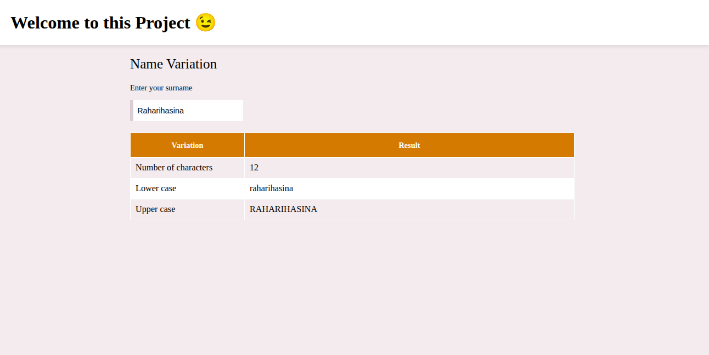

##Name Variation Project
This is a practice about the property '.length' and the methods '.toUpperCase()' and '.toLowerCase()'.

###Here is how it should look like when it's done: 

Thank you so much! Don't forget to enjoy every single part of the journey 👌🏾
